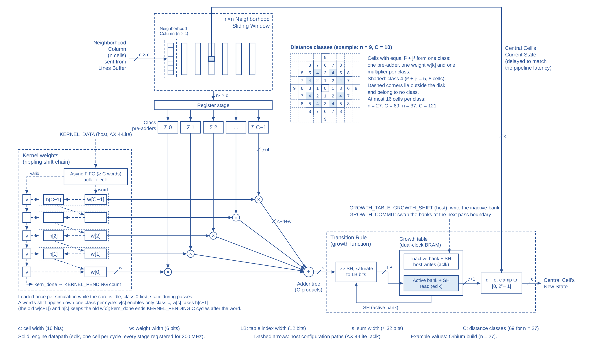

# Lenia rule for the CA framework: design

Date: 2026-10-31. Status: draft for approval. Builds on `docs/superpowers/specs/2026-10-24-ca-sv-framework-design.md` (the framework spec, "the base spec" below); everything not stated here follows the base spec.

## 1. Intent

The framework's end goal is a fixed-point Lenia accelerator on the original architecture: a grid-lines buffer streams one neighbourhood column per engine cycle into an N x N window, and a rule computes one new cell per cycle regardless of N. Lenia (continuous states, a smooth ring-shaped kernel and a smooth growth function) is the natural next rule, because its cost is a large weighted neighbourhood sum, exactly what this architecture parallelises; software implementations resort to FFT convolution for the same reason.

Lenia becomes a fourth rule plug-in, `RULE_LENIA`, inside the existing framework (RTL, golden model, tools, host). It must be explorable at run time in the spirit of the legacy Exploration Mode engines, where G and K were user inputs and a 29 x 29 window emulated a 19 x 19 one: the hardware fixes the maximum window, cell width and precision, while the kernel (once per simulation) and the growth function (live) are set by the host.

## 2. Goals

1. **G1 Lenia rule.** Single kernel, single channel, standard growth update `A' = clip(A + dt * G(K * A), 0, 1)`, with the kernel radius `R <= R_max = (NBH - 1) / 2` and the ring peaks `beta` programmable at run time through one weight per distance class.
2. **G2 Live growth function.** The growth function (mu, sigma and dt = 1/T) is a host-computed lookup table held in two banks; the host writes the inactive bank and commits, and the core switches banks only between passes. Every generation is computed with exactly one table, and the generation at which each switch took effect is reported, so runs with live changes can be replayed bit-exactly.
3. **G3 Bit-exact golden model.** One Python module generates the class map, the quantised weights and the growth table for the model, the host and the build tools; RTL equals the model bit for bit.
4. **G4 Precision.** Defaults `CELL_W = 16`, `WEIGHT_W = 6`, `LUT_IDX_W = 12`; 8-bit cells remain supported (6-bit or wider weights recommended).
5. **G5 200 MHz.** The engine datapath is designed for a 200 MHz engine clock.
6. **G6 Incremental.** Existing rules, configurations (`configs/*.json`), register offsets and results are unchanged; all six existing configurations still build and run bit-exactly.
7. **G7 1920x1080 by default.** RTL parameter defaults, configurations and seeds default to 1920x1080; tests use small sizes passed explicitly; running any configuration at 1920x1080 needs only its JSON file.
8. **G8 Host and display.** The host library and CLI load kernels and change the growth function; display boards show 16-bit cells.

## 3. Non-goals and anti-goals

Non-goals (the design must not preclude them, but they are not built now): multiple kernels, multiple channels, the asymptotic (target) update, soft clipping, non-radial programmable kernels, run-time changes of the window size or cell width, changing the kernel while a simulation runs, FFT, computing the bell function in hardware, and verifying timing or resources in Vivado (not available in this environment).

Anti-goals (failure even if it technically works):

* any change to the results or usability of the existing rules and configurations;
* a kernel distribution or load path that limits the 200 MHz clock, such as a central weight register file fanning out across the window;
* a generation computed with a mix of two growth tables or two kernels, or a live change that cannot be replayed bit-exactly;
* Lenia defaults below 1920x1080, or a 1080p run that needs an RTL or tool edit.

## 4. Evidence behind the precision choice

A bit-exact fixed-point model of the datapath below was compared with the floating-point update of the Lenia tutorial (lenia-org/Lenia-Tutorial, MIT licence) on Orbium (R = 13, 128 x 128) and Hydrogeminium (R = 18, three rings, 192 x 192) for 2000 steps. With 16-bit cells and 6-bit weights both creatures are statistically indistinguishable from the floating-point reference (speed within 0.7 %, size within 0.3 %, mass within about 1 %), with the result rounded or truncated to 16 bits; 5-bit weights also suffice. With 8-bit cells and 4-bit weights both creatures survive with speed and size within about 2 % when the increment is rounded in the table, plain truncation of a wider sum costs 2 to 6 %, and 4-bit weights make Orbium lock onto a grid axis. A 10-bit table index suffices for sigma = 0.015; 12 bits leave margin for narrower growth bands. Multi-kernel creatures, the asymptotic update and sigma below 0.015 were not tested.

## 5. Semantics (bit-exact)

Notation: `N = NBH` (odd), `R_max = (N - 1) / 2`, `CW = CELL_W`, `WW = WEIGHT_W`, `LB = LUT_IDX_W`, `MAXQ = 2^CW - 1`. A cell holds `q` in `[0, MAXQ]` and represents the state `A = q / 2^CW`. Window offsets `(i, j)` are (row, column) offsets from the centre, as in the base spec.

**Distance classes.** For every window offset with `d = i^2 + j^2 <= R_max^2`, the class of `(i, j)` is the rank of `d` among the distinct values of `d`, in ascending order, so class 0 is the centre. `C` is the number of classes: 69 for N = 27, 78 for N = 29, 121 for N = 37 (at most 16 cells per class). Offsets with `d > R_max^2` belong to no class and never contribute.

**One generation**, for every computed cell, with the window and boundary handling of the base spec (all four boundary modes apply; Lenia normally uses `toroidal`):

```
S   = sum over classes c of  w[c] * (sum of q over the cells of class c)      (exact, unsigned)
idx = min(S >> SH, 2^LB - 1)                                                  (SH from the active bank)
e   = table_active[idx]                                                       (signed, CW + 1 bits)
q'  = clamp(q_centre + e, 0, MAXQ)
```

`w[c]` is an unsigned `WW`-bit class weight and `SH` (0 to 63) the shift stored with the active table bank.

**Generation of weights and tables** (`model/ca_model/lenia.py`, the only implementation, used by the model, the host and `tools/gen_cfg.py`):

* `kernel_weights(R, beta, nbh, ww)`: with `B = len(beta)` and `D = sqrt(d) / R * B`, `K(d) = (D < B) * beta[min(floor(D), B - 1)] * bell(D mod 1, 0.5, 0.15)`, `bell(x, m, s) = exp(-((x - m) / s)^2 / 2)`; `w[c] = round(K(d_c) / max K * (2^ww - 1))`. Requires `1 <= R <= R_max`.
* `growth_table(mu, sigma, T, w, nbh, cw, lb)`: `wsum` = sum of `w` over all cells (each class weight times its cell count), `smax = wsum * MAXQ`, `SH = max(0, bitlen(smax) - lb)`; for every `idx` in `[0, 2^lb)`, with the bucket centre `U = (idx * 2^SH + (2^SH - 1) / 2) / (wsum * 2^cw)`, the entry is `round(dt * (2 * bell(U, mu, sigma) - 1) * 2^cw)` with `dt = 1 / T`, clamped to `[-2^cw, 2^cw - 1]`. The clamp only removes `+2^cw` at `dt = 1`, which saturates to the same result. The kernel normalisation (sum of K = 1) and dt therefore live in the table, so the hardware needs no divider and no dt multiplier.

## 6. Hardware

### 6.1 Rule datapath (`rtl/rules/ca_rule_lenia.sv`)



*The Lenia CA Engine, drawn after the CA Engine figure of the TRETS 2020 paper (Fig. 15): the per-cell weights become one weight per distance class, loaded through a shift chain, and the transition rule becomes the double-buffered growth table. Editable source: `docs/figures/lenia_engine.svg`.*

Pipelined at one cell per engine cycle, valid bit pipelined with `ca_valid_delay` (the framework accepts any rule latency):

1. **Window**: the existing `ca_window`.
2. **Class pre-add**: for each class, the sum of its 1 to 16 cells (`CW + 4` bits), with a register stage after the window and registered adder levels; class latencies equalised.
3. **Multiply**: each class sum times its local weight register, one multiplier per class, DSP-friendly with input, product and output registers (a 20 x 6-bit product fits one DSP48E1 at 16-bit cells).
4. **Sum of products**: a registered adder tree (or DSP cascade) over the `C` products, `S` about 33 bits wide at N = 37.
5. **Index**: pipelined right shift by `SH`, saturated to `LB` bits.
6. **Table read**: block RAM with registered output.
7. **Update**: saturating add of the entry to the delayed centre cell, registered.

Rules for 200 MHz: every adder level and the shifter stages are registered, the multipliers use their internal pipeline registers, the table output is registered, and window cells reach their class pre-adders through at least one register stage so that placement can bridge the distance between mirror-symmetric cells (staged symmetry folding is an acceptable structure). Weight registers sit next to their multipliers and are static during passes; their paths may be constrained as multicycle or false paths, but the design must not rely on that for function.

### 6.2 Kernel weights

* `C` weight registers of `WW` bits form a shift chain in class order. A new word enters at class `C - 1` and every load shifts the chain one class down, so after `C` loads the first word written sits in class 0: the host writes class 0 first.
* Path: AXI4-Lite writes to `KERNEL_DATA` (aclk) enter an asynchronous FIFO (the existing `ca_async_fifo`) and each word popped in the engine domain shifts the chain once. `STATUS.KERNEL_PENDING` is set while words are in flight. The FIFO holds at least `C` words (the next power of two), so a whole kernel written back to back over PCIe never overflows it.
* Writes are accepted only while no pass is active and RUN is clear; otherwise they are ignored. The controller starts no pass while `KERNEL_PENDING` is set, so no pass sees a partial kernel.
* Power-up values are the configuration's default kernel (FPGA register initial values from the generated configuration), so the default creature runs without a kernel load. Reset does not change the weights, consistent with the reset style (data registers are not reset).
* Amendment (2026-11-01, timing closure): one shared shift enable for all `C × WW` weight registers limited the routed 37 x 37 datapath to 163.5 MHz (5 ns of routing on that net). The shift now travels down the chain one class per cycle with the same result: a valid bit per class enables only that class, and class `c` takes the weight that class `c + 1` held before its own shift, kept in a hand-off register. The chain reports each word's arrival at class 0 (`kern_done`, `C` cycles after the word), and `KERNEL_PENDING` counts those pulses instead of the words leaving the FIFO; its counters gain one bit, since up to `C` further words can now be in flight. The wave's valid bits are not reset, so that no reset net spans the chain: a reset stops new shifts only, the shifts in flight complete, and their `kern_done` pulses are dropped for `C` cycles after the reset.

### 6.3 Growth table

* Two banks of `2^LB` entries of `CW + 1` bits in a dual-clock RAM: written from aclk, read in the engine domain (for example one RAM of depth `2^(LB+1)` with the bank as the top address bit).
* Each bank has its `SH` value. Host writes to `GROWTH_TABLE` and `GROWTH_SHIFT` always target the inactive bank and are ignored while a commit is pending.
* A write to `GROWTH_COMMIT` sets `STATUS.GROWTH_PENDING`. The controller swaps banks when no pass is active (immediately when idle, otherwise after the running pass and before the next one starts), latches `GEN_COUNT` into `GROWTH_GEN` and clears the pending bit. Generations up to `GROWTH_GEN` were computed with the old table and every later generation with the new one; this is the schedule a replay in the model uses.
* The active bank and its `SH` cross to the engine domain with the rule parameters at pass start (extend `ca_params_cdc`), so a pass uses one table from start to end.
* Power-up contents of both banks and both `SH` values come from the configuration's default growth table (a generated initialisation file read with `$readmemh`, which Vivado and Verilator both support).

### 6.4 Registers (additions; existing offsets unchanged)

The register file decodes 16 address bits instead of 8, so the map repeats every 64 KB (the XDMA template exposes a 64 KB BAR; the UART bridge carries 32-bit addresses). In cores built with another rule the new registers read 0 and ignore writes.

| Offset | Register | Access | Content |
|---|---|---|---|
| 0x08 | STATUS | RO | adds bit 3 KERNEL_PENDING, bit 4 GROWTH_PENDING, bit 5 GROWTH_BANK (active bank) |
| 0x34 | CORE_CFG | RO | rule field reads 3 for Lenia |
| 0x60 | LENIA_CFG | RO | [7:0] classes C, [11:8] WEIGHT_W, [15:12] LUT_IDX_W, [20:16] table entry width (CW + 1) |
| 0x64 | KERNEL_DATA | WO | [WW-1:0] next class weight (class 0 first); accepted only when idle |
| 0x68 | GROWTH_SHIFT | RW | SH of the inactive bank |
| 0x6C | GROWTH_COMMIT | WO | any write requests a bank swap |
| 0x70 | GROWTH_GEN | RO | GEN_COUNT when the last swap took effect |
| 0x8000 + 4 idx | GROWTH_TABLE | WO | entry `idx` of the inactive bank, [CW:0] two's complement (up to LB = 13) |

RESET_STATE does not touch kernels or tables (they are configuration, like the buffer addresses). The RULE_PARAM registers are unused by Lenia.

### 6.5 Integration

* `ca_pkg::rule_e` gains `RULE_LENIA = 4'd3`.
* `ca_engine` gains the Lenia case arm and three configuration inputs: the coefficient stream, the table write port in the aclk domain, and the active bank and `SH`. Other rules leave them unconnected.
* `ca_core`, `ca_core_flat`, the Verilog XDMA wrapper and the board tops gain integer-typed parameters `WEIGHT_W`, `LUT_IDX_W`, `KERNEL_DEFAULT` (`C * WW` bits) and the growth initialisation file, all generated by `tools/gen_cfg.py` from the JSON configuration.
* The core's elaboration checks extend to the Lenia constraints (for example `WEIGHT_W <= 18`, the width of a DSP48E1 multiplier input, and `LUT_IDX_W <= 13`, the size of the table window).

### 6.6 Display of wide cells

`ca_palette` indexes its table with the `min(CW, 8)` most significant bits, so 16-bit cells need a 256-entry table rather than 65 536, and gains an 8-bit `viridis` palette for Lenia; the existing palettes and their results are unchanged. The host viewer applies the same mapping. The Nexys 4 DDR top currently derives its palette from `CELL_W` (8-bit cells get `legacy8`, all others `legacy4_windows`, which rejects 16-bit cells); it takes the configuration's `palette` instead, through the generated configuration. At 16-bit cells a 1080p60 display board moves about twice the DDR traffic of 8-bit cells (an estimated 4 Gbit/s on the Nexys 4 DDR, within its budget but unverified).

## 7. Software

* **Configuration** (`rule: "lenia"`): `"params": {"R": 13, "T": 10, "mu": 0.15, "sigma": 0.015, "beta": [1]}` and optional `"weight_w"` (default 6) and `"lut_idx_w"` (default 12). `mask` is not used, `cell_w` defaults to 16, and validation checks `R <= (nbh - 1) / 2`.
* **Golden model**: `step()` supports `lenia` bit-exactly, with a naive per-cell reference for tests. The fast path may compute `S` by FFT convolution in float64 rounded to integers, with an exactness assertion (fractional error below 0.25) and padding for the non-toroidal modes. A 1080p generation should take seconds, not minutes.
* **Seeds**: a new `seed_mode` `"unit16"` reads a 16-bit greyscale PNG whose value / 65535 is the state, converted with `q = round(state * 2^CW)` and clamped. `tools/compose_seed.py` places named creatures from `data/patterns/` (taken from the MIT-licensed Lenia tutorial, with its copyright notice added to `NOTICE` and `third_party/README.md`) at given positions, or writes a random soup, on a canvas of 1920x1080 by default.
* **Host**:
  * `CAController.load_kernel(R, beta)` stops, waits until idle, writes the `C` class weights and waits for KERNEL_PENDING to clear; because the table's normalisation depends on the kernel, it then rewrites the growth table for the current mu, sigma and T. `set_growth(mu, sigma, T)` writes the inactive bank and its shift, commits, waits for GROWTH_PENDING to clear and returns `GROWTH_GEN`. For Lenia configurations these two calls replace `set_params`, and `info()` recognises the Lenia rule and reads `LENIA_CFG`.
  * The CLI loads the configuration's kernel and table at start, and offers commands to nudge mu and sigma in both the host-paced and the display-paced mode.
  * `SimDevice` models the Lenia registers, the commit at pass boundaries and `GROWTH_GEN`, so the host flow is testable without hardware.

## 8. 1920x1080 as the default

The RTL parameter defaults of `ca_core`, `ca_core_flat`, `ca_regs`, `ca_frame_reader`, `ca_frame_writer` and `ca_line_buffer` become 1920 x 1080 (`ca_display_system` already is). Every test passes its size explicitly; the core test harness keeps small sizes as a test helper. New configurations `configs/lenia_orbium.json` (N = 27, several Orbiums on a 1920x1080 seed) and `configs/lenia_hydrogeminium.json` (N = 37) default to 1920x1080, and running them on any target is a matter of choosing the file.

## 9. Verification

1. **Model**: vectorised (and FFT) result equals the naive reference on random grids for all boundary modes, N from 5 to 9, CW 8 and 16, WW 4 to 8, LB 8 to 12, random weights and tables including zero and maximum weights, saturating sums, SH = 0 and large SH.
2. **Precision regression (model)**: Orbium at 128 x 128 with 16/6/12 stays alive for 500 steps with mass within 3 % and speed within 2 % of the floating-point tutorial update; Hydrogeminium at 192 x 192 within 3 % in speed and size. This locks the precision decision.
3. **RTL unit (cocotb)**: `ca_rule_lenia` equals the model on random windows (N = 5, 7, 9 and 27; CW 8 and 16; random weights and tables); kernel chain order; table writes and bank selection; shift and saturation edges.
4. **Core integration (SV testbench, small sizes)**:
   * per-generation bit-exactness with random kernels and tables (N = 7, 64 x 32, toroidal and zero), and Orbium at 128 x 128 for 3 generations;
   * a growth commit while passes run, both host-paced and with continuous requests: each generation matches the model with the table schedule given by GROWTH_GEN;
   * kernel writes are ignored while busy, and no pass starts while KERNEL_PENDING is set;
   * memory stalls and consumer backpressure, as for the other rules.
5. **Regression**: the full existing suite passes unchanged, including the core tests of all three existing rules, and the six existing configurations still run at full size for a few generations (`tools/run_rtl_experiment.py`, within the 200-generation limit), as do the Lenia configurations.
6. **Static**: `make lint` and `make lint-boards` clean, slang elaboration of both board tops with a Lenia configuration, and the clock feasibility check unchanged.
7. **200 MHz**: the rules of 6.1, plus an out-of-context Vivado synthesis and implementation script for `ca_rule_lenia` (N = 27, CW = 16), run in the user's first Vivado session (unverified here).

## 10. Left to the builder

Pipeline depth per stage; the class pre-add structure (per-class trees or staged symmetry folding); fabric adder tree or DSP cascade for the products; RAM coding style and initialisation details; the model's convolution implementation; CLI command names and step sizes; the interface of `tools/compose_seed.py`; resource figures, which remain estimates until Vivado runs (for N = 27 at 16-bit cells: 69 multipliers of the Artix-7 100T's 240 DSPs, about 24 block RAMs for the line buffer and 4 for the growth tables).
